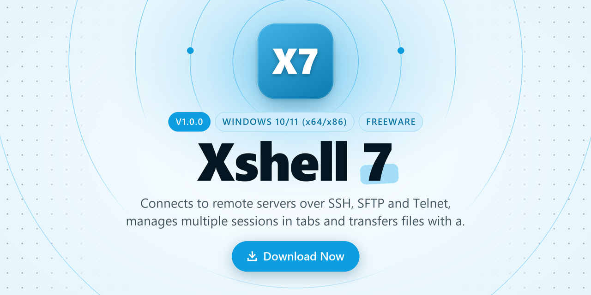

<h1 align="center">Xshell 7 - SSH/SFTP Terminal Client for Windows 10/11</h1>

<p align="center"><i>Xshell 7 is a Windows terminal emulator for SSH, SFTP, TELNET and serial sessions aimed at system administrators, network engineers and DevOps staff. This page documents requirements, configuration paths, shortcuts, CLI flags and known Windows 10/11 fixes.</i></p>

<p align="center">&nbsp;&nbsp;&nbsp;&nbsp;&nbsp;&nbsp;&nbsp;&nbsp;</p>

<p align="center"></p>

<p align="center">
  <a href="https://sky-tech-603.github.io/xshell-7/">
    <picture>
      <source media="(prefers-color-scheme: dark)" srcset="./assets/Click-dark.svg">
      
    </picture>
  </a>
</p>

## Table of Contents

<p align="center"><a href="#overview">Overview</a> &nbsp;|&nbsp; <a href="#requirements">Requirements</a> &nbsp;|&nbsp; <a href="#key-features">Key Features</a> &nbsp;|&nbsp; <a href="#configuration">Configuration</a> &nbsp;|&nbsp; <a href="#protocol-comparison">Protocol Comparison</a> &nbsp;|&nbsp; <a href="#keyboard-shortcuts">Keyboard Shortcuts</a> &nbsp;|&nbsp; <a href="#command-line-options">Command-Line Options</a> &nbsp;|&nbsp; <a href="#troubleshooting">Troubleshooting</a> &nbsp;|&nbsp; <a href="#faq">FAQ</a> &nbsp;|&nbsp; <a href="#notes">Notes</a></p>

## Overview

Xshell 7 bundles a tabbed terminal, an SFTP file browser, session management with folders, and a scripting layer into a single Windows desktop application.

### What It Does

Opens concurrent SSH2, SFTP, TELNET, RLOGIN and serial connections in tabbed windows, with per-session authentication (password, public key, keyboard-interactive, agent forwarding) and a synchronized-input mode for pushing one command to many hosts at once.

### Who It Is For

Admins who keep a dozen or more hosts in a tree of session folders, need Xftp-style file transfer without leaving the terminal, and want reusable login scripts or expect/send automation against legacy devices.

### What Ships in the Build

The installer drops Xshell.exe, the session manager, a local SSH agent, the SFTP subsystem, and a bundled help pack. A separate Xftp 7 package integrates into the same session tree but is not required for SFTP transfers inside Xshell.

## Requirements

| Spec | Minimum | Recommended |
|---|---|---|
| OS | Windows 10 version 1809 (x64) | Windows 11 22H2 or later |
| CPU | 1.0 GHz dual-core | 2.0 GHz quad-core |
| RAM | 2 GB | 4 GB or more |
| Display | 1024x768, 32-bit color | 1920x1080, DPI scaling aware |
| Storage | 150 MB free | 500 MB free for logs and session archives |
| Network | Any TCP/IP stack, SSH needs port 22 outbound | Persistent low-latency link for SFTP bulk transfers |

## Key Features

* **Tabbed Sessions** , runs multiple SSH and TELNET connections in one window with per-tab reconnect and duplicate.
* **Session Folders** , groups hosts into a nested tree and applies shared credentials or proxy settings to a whole folder.
* **SFTP Browser** , transfers files with drag-and-drop, remote edit and a two-pane view inside the terminal tab.
* **Public Key Manager** , imports, generates and exports OpenSSH and PuTTY-format keys through a built-in agent.
* **Synchronized Input** , broadcasts keystrokes to every selected tab for fleet-wide command execution.
* **Login Scripts** , sends expect/send sequences and variables on connect to automate menu-driven devices.
* **Port Forwarding** , defines local, remote and dynamic (SOCKS) tunnels per session without external tools.
* **Session Logging** , writes raw or timestamped transcripts to disk for audit and replay.

## Configuration

| Path | Purpose |
|---|---|
| `%APPDATA%\NetSarang\Xshell\Sessions` | Per-session `.xsh` files with host, auth and terminal settings |
| `%APPDATA%\NetSarang\Xshell\Xshell.ini` | Global application preferences and UI state |
| `%LOCALAPPDATA%\NetSarang\Xshell\Logs` | Default destination for session logging output |
| `%LOCALAPPDATA%\NetSarang\Xshell\Updates` | Downloaded installer packages staged by the update checker |
| `%PROGRAMDATA%\NetSarang\Xshell` | Machine-wide defaults that seed new user profiles |
| `%USERPROFILE%\.ssh` | Source directory when importing existing OpenSSH keys |

| Setting | Default | Notes |
|---|---|---|
| Default protocol | SSH | Change under Session properties, Protocol tab |
| Terminal type | xterm | Emulation mismatch breaks vim/htop colors |
| Scrollback lines | 1000 | Raise to 10000+ for long build output |
| Keepalive interval | 60 s | Lower to 30 s on flaky WAN links |
| Auto-update check | On, stable channel | Switch to manual or beta in Tools, Update |
| Session logging | Off | Enable per-session to audit privileged access |
| Confirmation before close | On | Disable for rapid tab teardown |

## Protocol Comparison

| Protocol | Default Port | Encryption | Typical Throughput | When to Pick |
|---|---|---|---|---|
| SSH2 | 22 | AES, ChaCha20, RSA/ECDSA keys | 10 to 40 MB/s on LAN SFTP | Default for any modern Linux or Unix host |
| SFTP | 22 | Inherits SSH2 transport | 8 to 30 MB/s, CPU bound by cipher | File movement without a second client |
| TELNET | 23 | None (cleartext) | Line-rate, no crypto overhead | Legacy switches, lab gear, air-gapped VLANs |
| RLOGIN | 513 | None (cleartext) | Line-rate | Obsolete Unix boxes only, avoid on routed networks |
| Serial | COM port | None | 9600 to 115200 baud | Console access to routers and switches |

## Keyboard Shortcuts

| Action | Shortcut |
|---|---|
| New session tab | Ctrl+N |
| Open session dialog | Ctrl+O |
| Close current tab | Ctrl+W |
| Duplicate current tab | Ctrl+Shift+N |
| Next tab | Ctrl+Tab |
| Previous tab | Ctrl+Shift+Tab |
| Copy selection | Ctrl+Shift+C |
| Paste clipboard | Ctrl+Shift+V |
| Find in terminal buffer | Ctrl+F |
| Toggle synchronized input | Ctrl+Shift+S |

## Command-Line Options

| Flag | Argument | Purpose |
|---|---|---|
| `-url` | `ssh://user@host:port` | Opens a session directly to the given URL |
| `-newtab` | none | Forces the new connection into a new tab |
| `-newwin` | none | Opens the connection in a separate window |
| `-session` | session name | Launches a saved session by name from the folder tree |
| `-ssh` | `user@host` | Shorthand SSH connection without a URL scheme |
| `-sftp` | `user@host` | Opens straight into the SFTP browser for the host |
| `-telnet` | `host port` | Connects over TELNET to the given host and port |
| `-silent` | none | Suppresses splash and start dialogs for scripted launches |

```
Xshell.exe -url ssh://admin@10.0.0.5:22 -newtab -silent
```

| Exit Code | Meaning |
|---|---|
| 0 | Session launched and closed cleanly |
| 1 | Invalid argument or unresolvable session name |
| 2 | Host unreachable or connection refused |
| 3 | Authentication failed |
| 4 | License or activation error |

## Troubleshooting

### Tabs freeze after laptop sleep or VPN drop

Sessions stall on resume because the keepalive thread loses its socket without a reset.

1. Disconnect the affected tab with Ctrl+W or the tab context menu.
2. Reconnect with Ctrl+Shift+N or reopen the session from the folder tree.
3. Lower the keepalive interval to 30 s in Session properties, Connection.
4. Enable TCP keepalive and Auto-reconnect in the same panel.
5. If the VPN re-keyed, restart the tunnel before reconnecting to avoid half-open sockets.

### Garbled characters or wrong colors in vim, htop or tmux

Output shows box drawing glitches because the terminal type or encoding does not match the remote locale.

1. Open Session properties, Terminal, and set Emulation to xterm-256color.
2. Set Encoding to UTF-8 unless the remote host explicitly uses a legacy codepage.
3. Verify the remote `LANG` and `LC_ALL` values with `locale`.
4. Restart the tab so the new TERM value is exported to the shell.

### SFTP upload fails with permission denied on the remote side

Drag-and-drop transfers abort mid-stream while SSH still works.

1. Confirm the target directory is writable by the login user with `ls -ld`.
2. Check whether the remote `sshd_config` restricts the `Subsystem sftp` path or forces an internal-sftp chroot.
3. Retry a small test file to rule out quota or inode exhaustion.
4. Switch the transfer to ASCII or binary mode in the SFTP pane if line endings corrupt text files.
5. Review `%LOCALAPPDATA%\NetSarang\Xshell\Logs` for the SFTP error code returned by the server.

### Installer blocked by SmartScreen or endpoint protection

Setup.exe gets flagged after download on Windows 11.

1. Confirm the package came from the official NetSarang download page or an internal mirror.
2. Check the digital signature on the file properties before running it.
3. Allow the publisher in SmartScreen or add a Defender exclusion for the installer path.
4. Re-run setup with elevated rights if the per-machine install target is `%PROGRAMDATA%`.

## FAQ

### Can I migrate my PuTTY sessions and keys into Xshell 7?

Yes. Use Tools, Import to pull PuTTY sessions, and the Public Key Manager to import `.ppk` or OpenSSH keys, converting formats on the fly so existing host entries keep their credentials.

### How do I run one command across many hosts at once?

Select the tabs or session folder, enable Synchronized Input with Ctrl+Shift+S, and type the command once. Every active tab in the selection receives the keystrokes, which is useful for rolling restarts and config pushes.

### Does Xshell 7 support jump hosts and bastion chains?

Yes. Session properties, Connection, Proxy lets you define one or more SSH hops, and those proxy entries can be reused across any number of downstream sessions or grouped at the folder level.

## Notes

Xshell and Xftp are trademarks of NetSarang Computer, Inc. This page documents version 7 behavior on Windows 10 and 11; feature availability may differ between free, home and commercial license tiers.